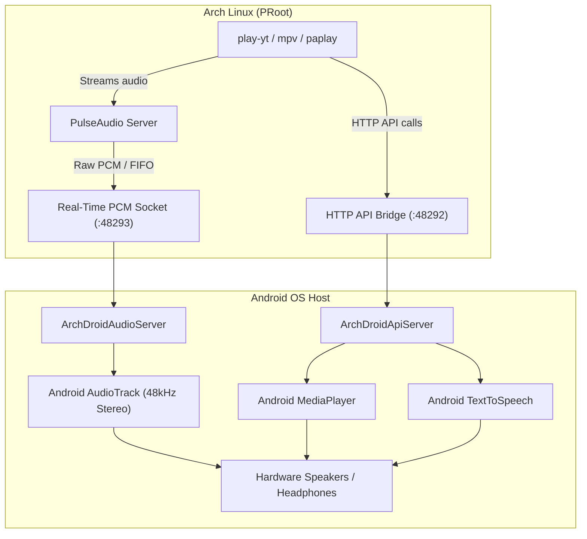

# 🎵 ArchDroid Player & Audio Subsystem

> Complete hardware-accelerated audio suite and YouTube music streamer for **ArchDroid** (Arch Linux on Android via PRoot).

[](#)
[](#)
[](LICENSE)

---

## 🌟 Overview

Running Linux in Android containers (PRoot/Termux) normally suffers from a lack of raw `/dev/snd` ALSA devices due to Android kernel SELinux restrictions. 

**ArchDroid Player** bridges Linux userspace tools directly to Android's native audio hardware across two high-performance tiers:
1. **Tier 1 (HTTP Bridge on `127.0.0.1:48292`)**: Direct Android `MediaPlayer`, native `TextToSpeech`, and system stream volume controls.
2. **Tier 2 (Real-Time PCM Sink on `127.0.0.1:48293`)**: Ultra-low-latency 48kHz 16-bit stereo `AudioTrack` sink with automated PulseAudio pipe-sink bridging.

Includes **`play-yt`**, a lightweight CLI player that searches YouTube, resolves the best audio stream, displays system toasts & notifications, and plays music in the background through your phone's speakers.

---

## 🚀 One-Line Installation (For Other Devices)

On any new ArchDroid installation or other device, run:

```bash
curl -fsSL https://raw.githubusercontent.com/eliakimrosil/archdroid-player/main/install.sh | bash
```

Or clone and install locally:

```bash
git clone https://github.com/eliakimrosil/archdroid-player.git ~/Projects/archdroid-player
cd ~/Projects/archdroid-player
./install.sh
```

---

## 🎧 Command Reference & Examples

### 1. YouTube Music Streamer (`play-yt`)
Instantly search and stream music from YouTube in the background:

```bash
# Play by song title or artist
play-yt "calvin harris outside"
play-yt "daft punk get lucky"

# Play directly from a YouTube link
play-yt "https://www.youtube.com/watch?v=kXYiU_JCYtU"
```

### 2. Hardware Media Player (`archdroid-media-player`)
Hardware-accelerated playback for local files and remote HTTP/HTTPS streams:

```bash
# Play local audio or remote URL
archdroid-media-player play /sdcard/Download/song.mp3
archdroid-media-player play "https://example.com/stream.mp3"

# Playback controls
archdroid-media-player pause
archdroid-media-player resume
archdroid-media-player stop
archdroid-media-player seek 45       # Seek to 45 seconds
archdroid-media-player volume 80     # Set player volume (0-100)
archdroid-media-player status        # Get live playback JSON
```

### 3. Android System Volume (`archdroid-volume`)
Inspect and adjust real Android OS volume streams:

```bash
archdroid-volume                    # View all volume levels
archdroid-volume music 80           # Set media/music volume to 80%
archdroid-volume notification 50    # Set notification volume
archdroid-volume alarm 100          # Set alarm volume
```

### 4. Text-To-Speech Synthesizer (`archdroid-tts`)
Speak text through Android's TextToSpeech engine:

```bash
archdroid-tts "System update completed."
echo "Temperature warning" | archdroid-tts -p 1.1 -r 0.95
```

### 5. Real-Time PCM & PulseAudio Bridge (`archdroid-audio`)
Real-time 48kHz 16-bit stereo PCM AudioTrack sink:

```bash
archdroid-audio status              # Check bridge and PCM sink status
archdroid-audio test                # Play test harmonic chime
archdroid-audio play song.wav       # Stream audio file in real time via ffmpeg
archdroid-audio setup-pulse         # Bridge PulseAudio to the native PCM sink
```

---

## 🏛 Architecture



---

## 📦 Included Files

| File | Description |
| :--- | :--- |
| [`bin/play-yt`](bin/play-yt) | YouTube streamer with query search and notification integration |
| [`bin/archdroid-media-player`](bin/archdroid-media-player) | Hardware-accelerated MediaPlayer controller |
| [`bin/archdroid-audio`](bin/archdroid-audio) | Low-latency PCM sink client & PulseAudio setup |
| [`bin/archdroid-volume`](bin/archdroid-volume) | System stream volume adjuster |
| [`bin/archdroid-tts`](bin/archdroid-tts) | Native Android TTS synthesis client |
| [`install.sh`](install.sh) | Self-contained one-line / local installer |
| [`uninstall.sh`](uninstall.sh) | Clean uninstaller script |

---

## 🛠 Dependencies

The installer will automatically install all missing dependencies via `pacman`:
- `yt-dlp`: For YouTube metadata and stream extraction.
- `ffmpeg`: For real-time PCM audio encoding and transcode.
- `pulseaudio`: For standard Linux audio server bridging.
- `curl`: For communicating with the ArchDroid IPC bridge.

---

## 📄 License

This project is licensed under the [MIT License](LICENSE).
